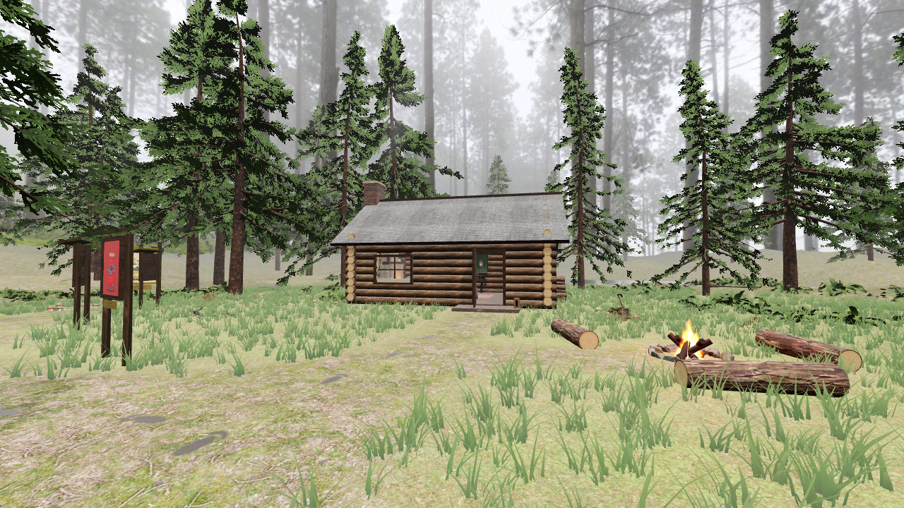
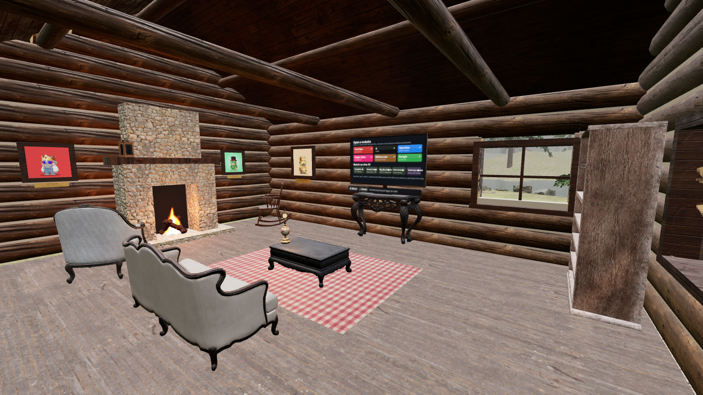

# Lil' Foots VR — Misty Pine Cabin (WebXR)

**Live:** https://mcontwitter-glitch.github.io/lil-foots-vr/

A photoreal-ish overcast pine forest built with three.js (r170) and WebXR. It has a log cabin you can walk into, a stone fireplace, a lake, a campfire, the BIGfoot.biz sign, footprints and the Lil' Foots gallery. Inside the cabin there's a TV that opens websites, plays videos and can cast your screen.

It works on Meta Quest 2/3 in the Quest Browser and on desktop browsers. Click **Enter VR** to start.

## Controls
| | VR (Quest) | Desktop |
|---|---|---|
| Walk | Left thumbstick | WASD / arrows (Shift = run) |
| Turn | Right thumbstick (30° snap turn) | Drag the mouse, or Q/E |
| Teleport | Hold the trigger, aim the arc, release | — |
| Use the TV | Point the laser at the TV and pull the trigger | Click the TV |

Walls, the fireplace, the woodpile, tree trunks and the lake all block you.

The HUD buttons jump you inside or outside, toggle sound, and switch between HQ and Lite. There's also a field to paste a video URL.

URL options:
- `?hq=1` / `?lite=1` force a quality level. Quest and phones default to Lite.
- `?video=<url>` autoplays a video on the TV.
- `?view=interior|tv|exterior` sets the start position.

## The TV
- **Websites:** YouTube, X, OpenSea, Magic Eden, BIGfoot.biz and Google. A browser cannot draw another site (cross-origin) inside a WebGL/WebXR scene, so picking a tile opens the site in a real browser tab (`window.open`, triggered by your click) and exits VR. If the popup is blocked, a link card appears.
- **Videos on the TV:** any mp4/webm/HLS (.m3u8) URL that is served with CORS headers. HLS uses hls.js, which is loaded only when needed. The presets are public-domain/CC clips and a Mux test stream. YouTube/X/Netflix pages can't be played on the TV because they aren't raw video files with CORS.
- **Cast my screen:** uses `getDisplayMedia`. It only appears where the browser supports it (desktop Chrome/Edge/Firefox). The Quest Browser generally doesn't offer it inside VR.

## Performance
Lite mode (the default on Quest) has:
- about 72 trees, 15 of them with high LOD
- 2.6k grass clumps
- 40 ferns
- a 1024 px static shadow map (shadows are baked once, not re-rendered every frame)
- pixel ratio 1

Headless measurements:
- **Lite:** about 0.9 M triangles / 300 draw calls at the busiest outdoor view, and about 0.5–0.57 M triangles / 100–170 calls inside. Grass and ferns are hidden while you're inside.
- **HQ:** about 1.4–1.7 M triangles outdoors.

Trees and grass are instanced and split into angular chunks so frustum culling works. On a Quest 2 the busiest outdoor views may dip below 72 fps; inside the cabin is lighter.

The download is about 18.5 MB (145 files, before gzip).

## Credits / licenses
- HDRI "Misty Pines", textures (rough_wood, grey_roof_01, red_brick_03, stone_wall, old_wood_floor, leafy_grass, forrest_ground_01, fabric_pattern_07, weathered_brown_planks) and 3D models (fern_02, rock_moss_set_01/02, tree_stump_01, dead_tree_trunk, dry_branches_medium_01, shrub_03, stone_fire_pit, wooden_axe, wooden_bucket_01, wooden_lantern_01, Sofa_01, ArmChair_01, CoffeeTable_01, Rockingchair_01, ClassicConsole_01, wooden_bookshelf_worn, vintage_oil_lamp) are from [Poly Haven](https://polyhaven.com), **CC0**.
- The pine trees were generated with [ez-tree](https://github.com/dgreenheck/ez-tree) by Daniel Greenheck (**MIT**, see `tools/EZTREE_LICENSE`). The pine bark texture is CC0 (texturecan).
- [three.js](https://threejs.org) and its addons, including `waternormals.jpg`, are **MIT**. [hls.js](https://github.com/video-dev/hls.js) is **Apache-2.0** and is loaded from jsDelivr.
- Preset videos:
  - Campfire (Wikimedia Commons, CC0)
  - Grand Canyon North Rim snowy forest (NPS, public domain)
  - *Big Buck Bunny* © Blender Foundation, **CC BY 3.0**, peach.blender.org
  - Mux public HLS test stream
- The Lil' Foots art and the BIGfoot.biz branding belong to their owner.

## Dev
Static site with no build step: `python3 -m http.server` and open `index.html`. The `tools/` folder has the ez-tree generator page that was used to export `assets/trees/*.glb`.
